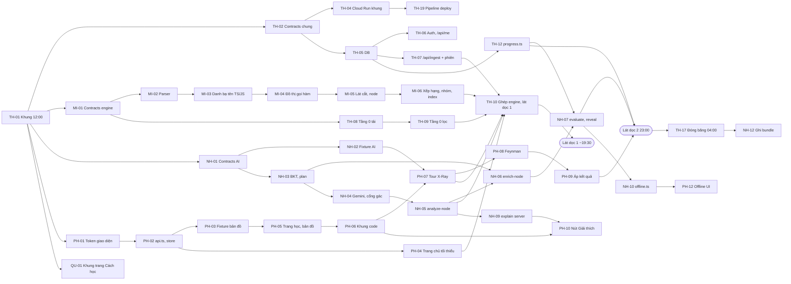

# 04 — Đồ thị phụ thuộc, đường găng và timeline

> H+0 = **12:00 thứ Bảy 07/11/2026**. H+12 = 00:00 Chủ nhật 08/11. H+16 = 04:00. H+21 = 09:00.
> Mọi thời lượng là **ước tính**, chưa đo. Mã phiếu ứng với các file `02_PHIEU_*.md`.

## 1. Đồ thị phụ thuộc giữa các phiếu

Mũi tên A → B nghĩa là B cần đầu ra của A. Phiếu của Quý (`QU-*`) không có mũi tên đi vào phiếu của người khác.

## 2. Đường găng

**Engine (Minh) → ghép (Thiện) → AI (Nhân) → Feynman (Phát) → đóng băng:**

TH-01 (12:00) → MI-01 (13:00) → MI-02 → MI-03 → MI-04 → MI-05 → MI-06 (19:30) → **TH-10 lát dọc 1 (19:30–20:00)** → NH-06 (enrich, đến 20:30) → NH-07 (evaluate, đến 22:30) → PH-09 (áp kết quả, đến 22:45) → **lát dọc 2 (23:00)** → TH-17 (**đóng băng 04:00**).

- Đường gần găng: chuỗi giao diện PH-02 → PH-05 → PH-06 → PH-07 (xong 19:45). Trễ quá 30 phút là đẩy lát dọc 1.
- Độ dư trên đường găng: từ lát dọc 2 (23:00) đến đóng băng (04:00) còn **5 giờ**. Phần lớn thời gian này đã có việc không thuộc đường găng (Java, giải thích đoạn chọn, offline, duyệt tay). Nghĩa là **trễ ở đường găng phải trả bằng cách cắt**, theo `01_KIEM_KE_VA_CAT_GIAM_NEU_TRE.md` Mục 4, chứ không được lấn sang giờ ngủ.
- Java/Spring (MI-08) **không nằm trên đường găng**. Nó chạy song song và có cổng riêng lúc 23:00.

## 3. Tải từng người

Giờ làm tính từ 12:00 tới 09:00, không tính 10:00–12:00 có mặt và kiểm máy.

| Người | Giờ làm trước đóng băng | Ngủ | Giờ làm sau đóng băng | Lúc tải cao nhất | Người đỡ lúc cao điểm |
| :-- | :-- | :-- | :-- | :-- | :-- |
| Thiện | 12:00–00:30 và 03:30–04:00 (≈ 13 giờ) | 00:30–03:30 | 04:00–09:15 | 16:15–20:00 (phiên học + Tầng 0 + ghép) | Không ai nhận thay merge; mỗi đợt merge giới hạn 10 phút |
| Minh | 12:20–01:00 (≈ 12,7 giờ) | 01:00–04:00 | 04:00–09:00 | 13:00–19:30 (toàn đường găng) | Thiện giữ engine giả cho tới TH-10 để không ai chờ Minh |
| Nhân | 12:20–04:00 (≈ 15,7 giờ) | 05:00–08:30 | 04:00–05:00, 08:30–09:00 | 18:30–22:30 (enrich + evaluate) | Thiện viết `progress.ts` (TH-12) để Nhân không phải làm transaction |
| Phát | 12:20–04:00 (≈ 15,7 giờ) | 05:00–08:00 | 04:00–05:00, 08:00–09:00 | 19:45–23:45 (Feynman, áp kết quả, nút Giải thích) | **Thiện** nhận trang chủ "Tiếp tục học" lúc 22:00 (TH-13); menu tài khoản tối giản (B21) |
| Quý | 12:20–21:30 và 00:30–04:00 (≈ 12,7 giờ) | 21:30–00:30 | 04:00–09:00 | Không nằm trên đường găng | Không cần |

Nhân và Phát nặng nhất trước đóng băng, nên được ngủ muộn và ngủ sát giờ lên sân khấu. Việc test, duyệt tay, slide, video được chia như sau:

| Việc | Người chính | Người dự phòng | Khi nào |
| :-- | :-- | :-- | :-- |
| Fixture bản đồ `shop-api` | Phát (PH-03) | Minh | 14:15 |
| Fixture phản hồi AI | Nhân (NH-02) | — | 13:00 |
| Test hàm thuần, kịch bản A/B | Nhân (NH-03) | — | 13:30 |
| Chạy repo demo trên engine thật | Minh (MI-07, MI-09) | Thiện | 19:30, 23:00 |
| Duyệt tay output AI | Nhân (NH-08, NH-11) | Thiện (người chưa đọc code repo demo) trả lời 10 câu NOVICE lúc 03:30 | 22:30, 02:30 |
| Definition of Done (`spec/50` Mục 5) | Thiện (TH-17) | Minh | 04:00 |
| Ghi bundle Offline | Nhân (NH-12) | Minh | 04:00 |
| Video dự phòng | Phát (PH-14, phần chạy thật) | Minh (MI-12, phần Offline) | 04:30, 05:30 |
| Slide nộp BTC | **Minh** (MI-12) | **Thiện** (TH-18) | 05:30–07:30 |

## 4. Timeline theo giờ

Cột "Mốc" là thứ **phải có** khi hết dòng đó. Lịch tổng duyệt chi tiết (08:00–09:30) chỉ ghi ở `06_THUYET_TRINH_VA_TRUOC_GIO_THI.md` Mục 3. Cột "Ai kiểm" là người xác nhận mốc. "Ngủ" là ngủ thật, không mở máy.

| Giờ thực | H+n | Thiện | Minh | Nhân | Phát | Quý | Mốc | Ai kiểm |
| :-- | :-- | :-- | :-- | :-- | :-- | :-- | :-- | :-- |
| 10:00–11:00 | H−2 | Điểm danh. Kiểm máy theo `06` Mục 4. Thử mạng di động dự phòng | Kiểm máy | Kiểm máy | Kiểm máy | Kiểm máy | 5 máy qua checklist, chưa ai commit | Thiện |
| 11:00–11:30 | H−1 | Kiểm repo thi trống, public, đủ 5 collaborator; nộp link BTC; hỏi BTC Q-01 | Đọc phiếu MI, soạn sẵn prompt agent (không viết code) | Đọc phiếu NH, soạn prompt | Đọc phiếu PH, soạn prompt | Đọc phiếu QU, soạn prompt | Link repo đã nộp | Thiện |
| 11:30–12:00 | H−0,5 | Minh điền repo TS/JS dự phòng vào `07_GHI_CHU_VA_CHOT.md` Mục 1 (13 câu khác đã chốt sáng 07/11); nhắc mỗi người: không tự chép `docs/`, chờ TH-01 rồi `git pull` (`03_GIT_PUSH_PULL.md` Mục 2) | Chờ | Chờ | Chờ | Chờ | **Không có commit nào trước 12:00** | Thiện |
| 12:00–12:30 | H+0 | **TH-01** commit đầu 12:00–12:20, báo cả đội pull; rồi **TH-02** | Pull lúc 12:20 ⇒ **MI-01** | Pull ⇒ **NH-01** | Pull ⇒ **PH-01** | Pull ⇒ **QU-01** | 12:20 cả đội đã pull commit đầu | Thiện |
| 12:30–13:00 | H+0,5 | TH-02; duyệt PR của MI-01, NH-01, PH-01, QU-01 | MI-01 | NH-01, gọi thử Gemini đo độ trễ | PH-01 | QU-01 | **13:00 contracts chốt; cả 5 người có commit trên `main`** | Thiện, lệnh `git shortlog -sn` |
| 13:00–14:00 | H+1 | **TH-03** (đến 13:20), **TH-04** | **MI-02** | **NH-02** (đến 13:30), **NH-03** | **PH-02** | **QU-02** | CI chạy trên PR | Thiện |
| 14:00–14:30 | H+2 | TH-04 xong. **Cổng G2** | MI-02 xong ⇒ **MI-03** | NH-03 | PH-02 ⇒ **PH-03** (14:15) | QU-02 | **Bản khung sống trên Cloud Run**, `/api/health` trả 200 `ok` | Nhân mở URL trên điện thoại |
| 14:30–15:30 | H+2,5 | **TH-05**; cửa sổ Claude thứ 2: **TH-19** (đặt secret, Environment trên repo trước) | MI-03 | NH-03 ⇒ **NH-04** (15:00) | **PH-04** (14:45) | QU-02 ⇒ **QU-03** (15:00) | Migration chạy trên Supabase | Thiện |
| 15:30–16:15 | H+3,5 | **TH-06**; TH-19 merge, duyệt `production` lần đầu | MI-03 ⇒ **MI-04** | NH-04 | PH-04 ⇒ **PH-05** (15:45) | QU-03 | Đăng nhập GitHub chạy ở máy | Phát |
| 16:15–17:00 | H+4,25 | **TH-07** | MI-04 | NH-04 ⇒ **NH-05** (16:45) | PH-05 | QU-03 | `/api/ingest` trả fixture qua engine giả | Phát |
| 17:00–18:00 | H+5 | **TH-08** | **MI-05** | NH-05 | PH-05 ⇒ **PH-06** (17:15) | QU-03 ⇒ **QU-04** (17:30) | Bản đồ từ fixture hiện trên `/learn` | Thiện |
| 18:00–19:00 | H+6 | **TH-09** | MI-05 ⇒ **MI-06** (18:30) | NH-05 ⇒ **NH-06** (18:30) | PH-06 ⇒ **PH-07** (18:30) | QU-04 ⇒ **QU-05** (19:00) | `analyze-node` trả phân tích thật ở máy | Nhân |
| 19:00–20:00 | H+7 | TH-09 xong ⇒ **TH-10**: merge, ghép, lát dọc 1 trên máy | MI-06 ⇒ **MI-07** (19:30) | NH-06 | PH-07 (đến 19:45) | QU-05 | **Lát dọc 1** (19:30–20:00). **Cổng G4** lúc 20:00 | Thiện + Minh |
| 20:00–21:00 | H+8 | Deploy + **cổng G3** (20:00–20:15), rồi **TH-11** | MI-07 ⇒ **MI-08** (20:30) | NH-06 ⇒ **NH-07** (20:30) | **PH-08** | QU-05 | `enrich-node` trả câu hỏi thật | Phát |
| 21:00–22:00 | H+9 | **TH-12** | MI-08 | NH-07 | PH-08 ⇒ **PH-09** (21:45) | QU-05 ⇒ **ngủ 21:30** | `progress.ts` merge | Nhân |
| 22:00–23:00 | H+10 | **TH-13** (nhận trang chủ từ Phát) | MI-08 | NH-07 ⇒ **NH-08** (22:30) | PH-09 ⇒ **PH-10** (22:45) | Ngủ | Chấm bài chạy ở máy | Phát |
| 23:00–23:45 | H+11 | **TH-14** deploy, đo lần 1 | **Cổng G5 Java** ⇒ **MI-09** | NH-08 ⇒ **NH-09** (23:30) | PH-10 | Ngủ | **Lát dọc 2** (23:00). Chốt repo demo | Thiện + Nhân |
| 23:45–00:30 | H+11,75 | **TH-15** (đến 00:15), **TH-16** (deploy `main` lúc 00:15) | MI-09 | NH-09 | PH-10 ⇒ **PH-11** (23:45) | Ngủ ⇒ dậy 00:30 | Đã diễn tập rollback và mở Vercel | Nhân |
| 00:30–01:00 | H+12,5 | **Ngủ** | **MI-10** bàn giao | **NH-10**, giữ quyền merge | PH-11 | **QU-06** | Minh ghi bàn giao trong PR | Nhân |
| 01:00–02:00 | H+13 | Ngủ | **Ngủ** | NH-10 | PH-11 | QU-06 | — | Nhân |
| 02:00–03:00 | H+14 | Ngủ | Ngủ | NH-10 ⇒ **NH-11** (02:30). **Cổng G6** | PH-11 ⇒ **PH-12** (02:00) | QU-06 ⇒ **QU-07** (02:30) | **Đủ endpoint giữ lại**; mọi việc Docker dừng hẳn | Nhân |
| 03:00–04:00 | H+15 | Dậy 03:30 ⇒ **TH-17**: trả lời 10 câu NOVICE (03:30–03:50), merge PR cuối (03:50–04:00) | Ngủ | NH-11 | **PH-13** (03:00) | QU-07 | Ảnh so với prototype đạt | Thiện |
| 04:00–05:00 | H+16 | TH-17: **đóng băng**, deploy production lúc 04:05, chạy DoD, đo lại | **MI-11** | **NH-12** ghi bundle | **PH-14**: sửa lỗi UI, quay video lúc 04:30 | **QU-08** | **04:00 đóng băng tính năng**. Production chạy bản đóng băng | Thiện |
| 05:00–06:00 | H+17 | **TH-18**: merge bundle, deploy lại lúc 05:00; trực sửa lỗi chặn demo | MI-11 ⇒ **MI-12** (05:30): slide, đoạn video Offline | **Ngủ** 05:00–08:30 | **Ngủ** 05:00–08:00 | QU-08 | Bundle Offline chạy hết kịch bản | Minh |
| 06:00–07:00 | H+18 | TH-18, tập nói phần hạ tầng | MI-12 | Ngủ | Ngủ | QU-08 | — | — |
| 07:00–08:00 | H+19 | TH-18: duyệt slide 07:30–07:40, tập phản biện cùng Minh 07:40–08:00 | MI-12 ⇒ **MI-13** (07:30) | Ngủ | Ngủ | QU-08 | **Slide bản 1 lúc 07:30** | Thiện |
| 08:00–08:30 | H+20 | Deploy cuối lúc 08:00; xem tổng duyệt 1 (Minh nói thay, Phát bấm) | MI-13 | Ngủ | **PH-15** | QU-08 | — | Thiện |
| 08:30–09:00 | H+20,5 | 08:30–08:45 push việc còn lại; 08:45 chạy lệnh kiểm `03` Mục 6; merge PR cuối | 08:30–08:45 push việc còn lại; 08:50 tổng duyệt 2 | **NH-13**: 08:30–08:45 push việc còn lại; 08:50 tổng duyệt 2 | 08:30–08:45 push việc còn lại; 08:50 tổng duyệt 2 | 08:30–08:45 push việc còn lại; bấm giờ | **09:00 ngừng code. Mọi người đã push hết** | Thiện, lệnh ở `03` Mục 6 |
| 09:00–09:30 | H+21 | **Nộp file thuyết trình lúc 09:15** (dự phòng: Minh) | Tổng duyệt 3 (hỏi ngang) | Tổng duyệt 3 (nói) | Tổng duyệt 3 (bấm) | Bấm giờ | **Đã nộp trước 09:30** | Minh xác nhận email gửi đi |
| 09:30–10:00 | — | Chuẩn bị máy demo theo `06` Mục 3 | Chuẩn bị | Chuẩn bị | Chuẩn bị | Chuẩn bị | 2 tab (Cloud Run, Vercel) đã đăng nhập; Offline thử 1 lần | Phát |
| 10:00–11:30 | — | Trả lời phản biện hạ tầng | Trả lời phản biện engine | **Nói chính** | **Bấm máy** | Bấm giờ, cầm điện thoại dự phòng | Thuyết trình và phản biện | — |

## 5. Lịch ngủ xoay

| Khoảng | Ngủ | Thức | Người giữ quyền merge |
| :-- | :-- | :-- | :-- |
| 21:30–00:30 | Quý | Thiện, Minh, Nhân, Phát | Thiện |
| 00:30–01:00 | Thiện | Minh, Nhân, Phát, Quý | **Nhân** |
| 01:00–03:30 | Thiện, Minh | Nhân, Phát, Quý | **Nhân** |
| 03:30–04:00 | Minh | Thiện, Nhân, Phát, Quý | Thiện |
| 04:00–05:00 | — | Cả 5 | Thiện |
| 05:00–08:00 | Nhân, Phát | Thiện, Minh, Quý | Thiện |
| 08:00–08:30 | Nhân | Thiện, Minh, Phát, Quý | Thiện |
| 08:30 trở đi | — | Cả 5 | Thiện |

- Mỗi người ngủ ít nhất 3 giờ liền. Người nói chính (Nhân) và người bấm máy (Phát) ngủ từ 05:00 tới 08:00–08:30, gần giờ lên sân khấu nhất.
- Trước khi ngủ, người đó giao việc cho agent trên nhánh riêng. Dậy phải tự kiểm rồi mới mở PR. Việc giao trước khi ngủ được chạy quá 30 phút.
- Ngủ là tắt chuông máy tính. Có lỗi chặn demo thì người giữ quyền merge quyết, không đánh thức ai, trừ khi production chết.

## 6. Cổng quyết định

Trễ được tính so với cột "Mốc" ở Mục 4. Cắt theo thứ tự ở `01_KIEM_KE_VA_CAT_GIAM_NEU_TRE.md` Mục 4. Không bao giờ cắt danh sách ở `01` Mục 1.

| Cổng | Giờ | Điều kiện đạt | Trễ ≥ 1 giờ hoặc không đạt thì làm gì | Ai quyết |
| :-- | :-- | :-- | :-- | :-- |
| G1 | 13:00 (H+1) | Contracts merge; 5 người có commit trên `main` | Ai chưa có commit thì commit ngay phần đang làm (vẫn phải là code thật), Thiện merge trong 10 phút | Thiện |
| G2 | 14:00 (H+2) | Cloud Run `--source` sống, `/api/health` 200 | Thiện viết Dockerfile ngay (14:00–15:00), TH-05 … TH-09 lùi 30 phút; lát dọc 1 có thể chạy bằng zip upload. Tới 15:30 vẫn chết: Vercel làm bản chính tạm thời, Cloud Run thử lại lúc TH-10 | Thiện |
| GP | 20:00 (H+8) và 00:00 (H+12) | Pipeline TH-19 đưa được bản lên `production` | 20:00 chưa đạt: lát dọc 1 deploy tay (`05` Mục 3), sửa pipeline trên nhánh riêng. 00:00 vẫn đỏ: bỏ pipeline, deploy tay tới hết giờ | Thiện |
| G3 | 20:15 (H+8,25) | Vertex AI gọi được từ Cloud Run (deploy lúc 20:00) | Chuyển `GEMINI_BACKEND="studio"` trên Cloud Run, key để trong Secret Manager (Q-04) | Thiện + Nhân |
| G4 | 20:00 (H+8) | Lát dọc 1 chạy trên máy Thiện | Trễ 1 giờ: cắt mục 1 (Java) và mục 2 (`/history`) ngay. Trễ 2 giờ: cắt thêm mục 3–4 | Thiện + Minh |
| G5 | 23:00 (H+11) | Lát dọc 2 chạy; Java ra ≥ `CONFIG.DISPLAY_MIN_NODES` bài đọc được trên repo Q-03 | Java chưa đạt ⇒ dừng Java, demo bằng repo TS/JS dự phòng (Q-02). Lát dọc 2 trễ ⇒ cắt mục 3–6 | Thiện + Minh + Nhân |
| G6 | 02:00 (H+14) | Đủ endpoint giữ lại; không còn nhánh Docker đang làm dở | Endpoint nào chưa xong thì ẩn nút ở UI. Nhánh Docker đóng không merge | Nhân (Thiện đang ngủ, quyết theo bảng này) |
| G7 | 04:00 (H+16) | **Đóng băng**: DoD đã lọc (`06` Mục 2) đạt | Mục nào không đạt thì ẩn khỏi demo. Sau 04:00 chỉ merge PR nhãn `fix-demo` hoặc `sau-dong-bang` (luật chung 10 ở `02_PHIEU_THIEN.md`) | Thiện |

## 7. Đệm cho agent làm sai

- Luật cũ giữ nguyên: agent chạy quá **30 phút** chưa xong thì dừng, chia nhỏ phiếu. Làm lại **tối đa 1 lần**, vẫn sai thì người tự code tay phần còn lại.
- Đệm có sẵn trong lịch: Minh có MI-09 (23:00–00:30), Nhân có NH-11 (02:30–04:00), Phát có PH-13 (03:00–04:00), Thiện có TH-15 và TH-16 (23:45–00:30). Phiếu đệm làm sau cùng, bị cắt trước tiên.
- Mỗi phiếu có mục "Nếu trễ" ghi rõ cắt gì và báo ai.

## 8. Sơ đồ Gantt

```mermaid
gantt
  title Lịch thi 07–08/11/2026 (H+0 = 12:00)
  dateFormat YYYY-MM-DD HH:mm
  axisFormat %H:%M
  section Thiện
  TH-01 Khung                  :crit, th01, 2026-11-07 12:00, 20m
  TH-02 Contracts chung        :crit, th02, after th01, 40m
  TH-03 CI                     :th03, after th02, 20m
  TH-04 Cloud Run khung        :th04, after th03, 70m
  TH-05 DB                     :th05, after th04, 60m
  TH-19 Pipeline (song song)   :th19, after th04, 105m
  TH-06 Auth, me               :th06, after th05, 45m
  TH-07 Ingest route, phiên    :th07, after th06, 45m
  TH-08 Tầng 0 tải             :th08, after th07, 60m
  TH-09 Tầng 0 lọc             :th09, after th08, 75m
  TH-10 Ghép, lát dọc 1        :crit, th10, after th09, 45m
  TH-11 Sessions, progress API :th11, after th10, 60m
  TH-12 progress.ts            :crit, th12, after th11, 60m
  TH-13 Trang chủ tiếp tục học :th13, after th12, 60m
  TH-14 Deploy, đo lần 1       :th14, after th13, 45m
  TH-15 Persona, history API   :th15, after th14, 30m
  TH-16 Rollback, Vercel       :th16, after th15, 15m
  Ngủ                          :done, ths, after th16, 180m
  TH-17 Đóng băng, DoD         :crit, th17, after ths, 90m
  TH-18 Trực, nộp slide        :th18, after th17, 255m
  section Minh
  MI-01 Contracts engine       :crit, mi01, 2026-11-07 12:20, 40m
  MI-02 Parser                 :crit, mi02, after mi01, 60m
  MI-03 Danh bạ tên TS/JS      :crit, mi03, after mi02, 90m
  MI-04 Đồ thị gọi hàm         :crit, mi04, after mi03, 90m
  MI-05 Lát cắt, node          :crit, mi05, after mi04, 90m
  MI-06 Xếp hạng, nhóm         :crit, mi06, after mi05, 60m
  MI-07 Repo dự phòng          :mi07, after mi06, 60m
  MI-08 Java, Spring           :mi08, after mi07, 150m
  MI-09 Sửa theo repo chốt     :mi09, after mi08, 90m
  MI-10 Bàn giao               :mi10, after mi09, 30m
  Ngủ                          :done, mis, after mi10, 180m
  MI-11 DoD engine             :mi11, after mis, 90m
  MI-12 Slide                  :mi12, after mi11, 120m
  MI-13 Tập bấm, commit cuối   :mi13, after mi12, 90m
  section Nhân
  NH-01 Contracts AI           :nh01, 2026-11-07 12:20, 40m
  NH-02 Fixture AI             :nh02, after nh01, 30m
  NH-03 BKT, plan              :nh03, after nh02, 90m
  NH-04 Gemini, cổng gác       :nh04, after nh03, 105m
  NH-05 analyze-node           :nh05, after nh04, 105m
  NH-06 enrich-node            :crit, nh06, after nh05, 120m
  NH-07 evaluate, reveal       :crit, nh07, after nh06, 120m
  NH-08 Lát dọc 2, duyệt tay   :nh08, after nh07, 60m
  NH-09 explain server         :nh09, after nh08, 60m
  NH-10 offline.ts             :nh10, after nh09, 120m
  NH-11 Duyệt tay AI           :nh11, after nh10, 90m
  NH-12 Ghi bundle             :nh12, after nh11, 60m
  Ngủ                          :done, nhs, after nh12, 210m
  NH-13 Commit cuối            :nh13, after nhs, 30m
  section Phát
  PH-01 Token giao diện        :ph01, 2026-11-07 12:20, 40m
  PH-02 api.ts, store          :ph02, after ph01, 75m
  PH-03 Fixture bản đồ         :ph03, after ph02, 30m
  PH-04 Trang chủ tối thiểu    :ph04, after ph03, 60m
  PH-05 Trang học, bản đồ      :ph05, after ph04, 90m
  PH-06 Khung code             :ph06, after ph05, 75m
  PH-07 Tour X-Ray             :ph07, after ph06, 75m
  PH-08 Feynman                :crit, ph08, after ph07, 120m
  PH-09 Áp kết quả             :crit, ph09, after ph08, 60m
  PH-10 Nút Giải thích         :ph10, after ph09, 60m
  PH-11 Tổng quan, menu        :ph11, after ph10, 135m
  PH-12 Offline UI             :ph12, after ph11, 60m
  PH-13 So prototype           :ph13, after ph12, 60m
  PH-14 Sửa lỗi, video         :ph14, after ph13, 60m
  Ngủ                          :done, phs, after ph14, 180m
  PH-15 Tập bấm, commit cuối   :ph15, after phs, 60m
  section Quý
  QU-01 Khung Cách học         :qu01, 2026-11-07 12:20, 40m
  QU-02 Nội dung 4 bước        :qu02, after qu01, 120m
  QU-03 16 thẻ khái niệm       :qu03, after qu02, 150m
  QU-04 Áp phích nháp          :qu04, after qu03, 90m
  QU-05 Lịch sử dữ liệu mẫu    :qu05, after qu04, 150m
  Ngủ                          :done, qus, after qu05, 180m
  QU-06 Lịch sử nối API        :qu06, after qus, 120m
  QU-07 Áp phích bản cuối      :qu07, after qu06, 90m
  QU-08 Hoàn thiện, commit     :qu08, after qu07, 300m
```

