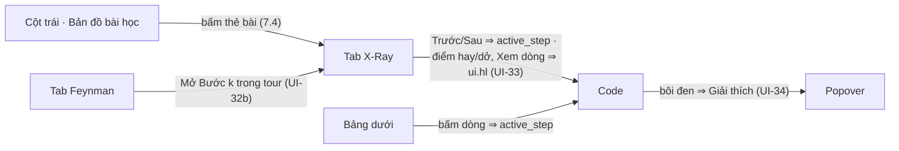

# 30 — GIAO DIỆN

> Các trang, trang học `/learn`, học theo tour, tương tác đồng bộ, offline và lỗi (D-78, D-79, D-81 … D-85, D-89) · đọc: Vai D, luồng 6.
> Code repo thi: `src/app/layout.tsx` (font, script chủ đề, `Boot`, `Toasts`) · `src/app/globals.css` (token) · `src/app/**/page.tsx` · `src/components/{code,home,layout,learn,ui}/*` · `src/store/workbench.ts` (Zustand) · `src/lib/api.ts` (trả response hoặc `ApiError`, không throw) · `src/lib/supabase/client.ts` · `src/lib/{bkt-engine,plan,derive,similarity,graph}.ts` (hàm thuần client/server, hiển thị và Offline) · `src/lib/concept-cards.ts` · `src/lib/offline.ts` · `src/lib/messages.ts` (Mục 10) · `public/demo/mock_bundle.json`.
> Kiểu: `02` · hằng số: `CONFIG.*` (`CONFIG.UI_PRESENTATION_FOCUS_PCT`, `CONFIG.UI_PRESENTATION_FONT_SCALE`, `CONFIG.REPORT_NOTE_MAX_CHARS`) · bất biến: `01` (INV-05, INV-06, INV-07, INV-11) · endpoint: `03` (`GET /api/sessions/{id}/progress` → `ProgressResponse`, `QuestionState.feynman_question`, `ERR_CLIENT_NETWORK`, `NEXT_PUBLIC_DEMO_MODE`) · BKT: `22`.

## Đọc nhanh

- Trang học `/learn` kiểu IDE (D-78): trái Bản đồ bài học (danh sách nhóm, D-84), giữa Code (Monaco, chỉ đọc, mỗi file 1 tab) + bảng dưới, phải 2 tab X-Ray / Feynman; khung ẩn/hiện, kéo tỉ lệ được.
- Học theo tour (D-81): thẻ vai trò ⇒ từng bước ⇒ tóm tắt ⇒ Feynman.
- 2 chủ đề sáng / tối (D-79), mặc định tối.
- Offline: `public/demo/mock_bundle.json`, 0 API, nhãn cảnh báo cố định.

Các phần điều khiển nhau:



---

## 1. Nguyên tắc

- **Bản sao chỉ đọc (D-02):** Store chỉ *thay* dữ liệu server; không tự tính BKT, trạng thái, mở khóa, số lượt, đáp án. `derive`, `bkt-engine`, `plan` chỉ hiển thị và Offline.
- **Tải trước có giới hạn (D-46, D-83):** `analyze-overview` gọi trước; `enrich-node` chỉ cho node đang mở; `analyze-node` chỉ chạy cho node đang mở và 1–2 node kế tiếp (tối đa `CONFIG.ANALYZE_CONCURRENCY` song song).
- **Đáp án:** Lấy từ `QuestionState.reveal`; câu chưa xong không có đáp án ở client (D-36).
- **Chữ thuần:** Văn bản AI là chữ thuần (không `dangerouslySetInnerHTML`, không Markdown); trong `` ` `` hiện mã nội dòng.
- **Nhãn nguồn:** Tên bài, tên nhóm do AI "AI đặt tên"; điểm dở "Nhận định của AI"; tổng quan "Nhận định của AI — có thể chưa chính xác"; đáp án "Đáp án mẫu" + "do AI viết".
- **Bậc người học (D-81):** lấy từ BKT, giao diện không có ô chọn bậc. Ô persona (Mục 9) chỉ cho demo.
- **Số liệu:** Lấy từ `CONFIG` hoặc response; chỉ hiện số thật, không hiện mục tiêu `02` Mục 1.1.
- **Màu sắc:** Kèm biểu tượng + chữ, không dùng màu đơn lẻ.
- **Lưu trữ:** `localStorage` chỉ chứa `sf.last_session`, `sf.prefs` (`theme`, `layout`); bọc `try/catch`. Cắt tính năng theo mục "Nếu trễ" của phiếu ⇒ ẩn nút.

---

## 2. Các trang & bố cục

| Trang | Nội dung |
| :-- | :-- |
| `/` | Chưa đăng nhập: màn hình đăng nhập. Đã đăng nhập: nhập link, thả zip, "Tiếp tục học" (Mục 2.1) |
| `/login`, `/register` | Màn hình đăng nhập GitHub, đã đăng nhập ⇒ về `/`; `/register` chuyển sang `/login` |
| `/roadmap`, `/roadmap/[courseId]` | Danh sách phiên học; danh sách bài của một phiên theo tô-pô (`StatusPill`, "Mở bài") |
| `/learn?session={id}` | Trang học (Mục 2.2) |
| `/history?session={id}`, `/report?session={id}` | Lịch sử nộp bài (mới nhất trước); báo cáo phiên (đếm node theo trạng thái, token, tỉ lệ đạt theo kỹ năng) |
| `/how-it-works` | 4 bước cách học |

Menu `Navbar`: Trang chủ · Trang học (khi có phiên) · Lộ trình · Lịch sử (có phiên, không Offline) · Cách học. Báo cáo mở từ thanh trên trang học. Trang phụ dùng `ui/Page.tsx` (`PageHeader`, `MetricCard`, `StatusPill`, `EmptyState`), chưa đăng nhập hoặc thiếu `session` ⇒ `EmptyState`.

### 2.1. Trang chủ `/`

- Ô link + "Quét repo" ⇒ `POST /api/ingest { repo_url }`; ô rỗng ⇒ nút tắt. Chỉ nhận link gốc repo (D-38): dưới ô luôn có ghi chú "Chỉ hỗ trợ nhánh mặc định."; link có `/tree/…`, `/blob/…` ⇒ vẫn quét (server cắt về gốc repo), client tự nhận trong ô link ⇒ ghi chú tô `--amber`, thêm "— link /tree/… hoặc /blob/… sẽ được cắt về gốc repo"; link sai dạng ⇒ `ERR_INVALID_GITHUB_URL` (Mục 10).
- Vùng thả nhận `.zip` ≤ `CONFIG.MAX_UPLOAD_BYTES` (D-27), kiểm ở client trước khi gửi (sai đuôi/quá cỡ ⇒ `ERR_UPLOAD_INVALID` / `ERR_STREAM_QUOTA_EXCEEDED`, thông điệp "Upload" ở Mục 10) ⇒ multipart trường `archive` (UI-11).
- **"Tiếp tục học":** `GET /api/sessions` (mới nhất trước), mỗi phiên 2 hàng: "shop-api · main @ 5be1c2a" (`repo_name`, `ref_label`, `snapshot_id` 7 ký tự, `ARCHIVE_HASH` thêm "zip", `subdir`) và "3/7 node (1 ✗) · 2 giờ trước" (`completed_count / total_nodes`, `failed_count`). "Lịch sử" ⇒ `/history?session={id}` (`AttemptHistoryItem`, xem `student_answer`).

| `can_resume` / `resume_blocker` | Nút chính |
| :-- | :-- |
| `true` | "Học tiếp" ⇒ `POST /api/ingest { session_id }`; "Học lại từ đầu" (D-42) ⇒ xác nhận "Mở phiên mới cho repo này: tiến độ node làm lại, điểm kỹ năng giữ nguyên, câu hỏi sinh mới." ⇒ `POST /api/ingest { session_id, restart: true }` |
| `ENGINE_UPDATED` | Chip "Engine đã cập nhật" + "Xem lịch sử" |

- Chưa đăng nhập: `LoginScreen` hiện "Đăng nhập GitHub" ⇒ `supabase.auth.signInWithOAuth({ provider: "github" })` ⇒ `/auth/callback` ⇒ vào app, kèm thẻ "Bản demo Offline". Offline `?offline=1` vẫn chạy không cần đăng nhập.
- Thẻ "Bản demo Offline" (nút + phím tắt) luôn có ở trang chủ. Có phiên đang mở ⇒ thẻ "Đang mở phiên {repo_name}" + "Vào trang học". Từ `lg` có hình trang trí `HeroArt`.
- **Đang quét:** `IngestOverlay` có vòng quét + đồng hồ thật, chặn ô link và vùng thả. Xong ⇒ ghi `sf.last_session`, chuyển `/learn?session={id}`, cột giữa hiện Tổng quan; `resumed` ⇒ toast "Đã mở lại {repo_name} — {completed}/{total} node". Lỗi ⇒ báo dưới vùng thả, `retryable` ⇒ "Thử lại".

### 2.2. Trang học `/learn`

- Từ trên xuống: `Navbar`, `CockpitHeader`, khu làm việc. Từ `lg`, trang cao đúng màn hình, 3 cột tự cuộn: trái `LessonGraphPanel`, giữa `CodeSnippetViewer` + `ProblemsPanel`, phải `LearnSidePanel` (tab X-Ray / Feynman).
- Nhỏ hơn `lg`: 1 cột theo thứ tự bản đồ → code → bảng dưới (nếu bật) → X-Ray / Feynman; khung code dính đầu màn hình khi cuộn (`position: sticky`, cao theo `prototype.html`); không cuộn ngang, không có nút bố cục và vạch kéo.
- **Bố cục (`learn/layout.ts`, `LayoutControls`, `Splitter`):** nút Bản đồ (`Ctrl+B`) ở đầu `CockpitHeader`; cuối thanh: menu "Tùy chỉnh bố cục", Bảng dưới (`Ctrl+Alt+J`), X-Ray/Feynman (`Ctrl+Alt+B`) ở mép phải. Vạch giữa các khung kéo được bằng chuột, chạm, phím mũi tên; bấm đúp, `Home`, `Enter` ⇒ đặt lại vạch đó; menu có "Đặt lại bố cục". Tỉ lệ mặc định (`LAYOUT_DEFAULT`, theo `prototype.html`) và giới hạn (`LAYOUT_LIMIT`) là hằng nội bộ, lưu `sf.prefs.layout`.
- **Bảng dưới (`ProblemsPanel`):** mặc định ẩn. Tab "Điểm dở — Nhận định của AI" (`what`, vị trí, bước, kỹ năng) và "Luồng" (bước, tầng, hàm, file), đọc từ `analyses`, `trace_steps`; bấm dòng ⇒ `active_step`. Không hiện cách sửa (INV-06).
- `CockpitHeader` mở cửa sổ Tổng quan (Mục 6.3).
- **Trình chiếu:** Nút "Trình chiếu" ở đầu khung code hoặc trong menu bố cục ⇒ cột code rộng `CONFIG.UI_PRESENTATION_FOCUS_PCT`, 2 cột còn lại chia đều phần còn lại (bỏ qua tỉ lệ đã kéo, ẩn vạch kéo; cột đang ẩn vẫn ẩn), cỡ chữ Monaco × `CONFIG.UI_PRESENTATION_FONT_SCALE`; `Esc` / "Thoát trình chiếu" ⇒ thoát. Header và nhãn Offline luôn hiện.

### 2.3. Thanh trên trang học

| Phần tử | Nguồn ⇒ hiển thị / hành vi |
| :-- | :-- |
| Repo | `repo_name · ref_label @ sha7` (`ARCHIVE_HASH` thêm "zip"), `ref_label` rỗng ⇒ `repo_name · @ sha7`; "Repo khác" ⇒ xóa phiên + `sf.last_session` (giữ `profile`), về `/` |
| Vân tay | Chip `archetype` (`detected_framework` ở Mục 4); `is_monorepo` ⇒ "Monorepo · {root_dir_offset}", `report.selective_fetch` ⇒ "Repo lớn · {root_dir_offset}"; cả hai có "Đổi thư mục" (chỉ phiên GitHub, không Offline) ⇒ hộp thoại "Đổi thư mục phân tích" ⇒ `POST /api/ingest { repo_url, subdir_override }`, xong thay URL |
| Đo | "Bản đồ {ingest_ms + engine_ms} ms · 0 token"; bấm ⇒ `ui.metrics`: "Tải+lọc {ingest_ms} ms · đồ thị {engine_ms} ms · {code_file_count} file code" |
| Token | "{progress.tokens_used} / {CONFIG.SESSION_TOKEN_QUOTA}"; tooltip: "~{cost} USD (ước tính)"; ≥ quota ⇒ đỏ; Offline ⇒ "0 token" |
| Nút | "Tổng quan" ⇒ Mục 6.3 · "Lịch sử" ⇒ `/history?session={id}` · "Báo cáo" ⇒ `/report?session={id}` (2 nút này ẩn ở Offline) · "Repo khác" · nút bố cục (Mục 2.2) |
| Tài khoản (`Navbar`) | Avatar (`user_metadata.avatar_url`) + `display_name` + `overall_tier`. Menu: "Mở demo Offline (Ctrl+Shift+D)", "Đăng xuất" (`signOut()` ⇒ về màn hình "Đăng nhập GitHub"), "Xóa tài khoản và dữ liệu". Offline: tên "Offline", menu "Tắt chế độ Offline" |
| Chủ đề (`Navbar`) | Nút "☀ Chế độ sáng" / "☾ Chế độ tối" ở mọi trang (Mục 11) |

Nhãn Offline: UI-60. Persona: Mục 9.

- **Xóa tài khoản:** "Xóa toàn bộ điểm kỹ năng, phiên học, câu trả lời. Không hoàn tác." ⇒ `DELETE /api/me` ⇒ xóa `sf.*` ⇒ `signOut()` ⇒ tải lại.

---

## 3. Cây component

| Component | Vai trò | Đọc store |
| :-- | :-- | :-- |
| `layout/Navbar`, `layout/Boot` | Menu trang, nhãn Offline, persona, chủ đề, tài khoản; khởi động 1 lần, phím `Ctrl+Shift+D` | `profile`, `is_offline_mode`, `ui.auth` |
| `learn/LearnShell`, `learn/layout`, `LayoutControls`, `Splitter` | Khung trang học, ẩn/hiện, kéo tỉ lệ, phím tắt | `session_id`, `ui.presentation`, store `useLayout` |
| `learn/CockpitHeader` | Thanh trên trang học | `result`, `progress.tokens_used`, `ui.metrics` |
| `learn/LessonGraphPanel` | Cột trái: đầu cột, cảnh báo, danh sách nhóm, chú giải | `result`, `progress.nodes`, `analyses`, `overview`, `active_node_id`, `ui.open_groups` |
| `learn/LessonGroup`, `LessonCard` | Khối nhóm, thẻ bài | Nhận qua props |
| `learn/CodeSnippetViewer`, `code/MonacoPane`, `code/slice-model`, `code/SelectionPopover` | Tab file, code của bước, giải thích đoạn chọn | node đang mở, `active_step`, `analyses[active]`, `ui.hl`, `ui.explanations` |
| `learn/ProblemsPanel` | Bảng dưới | node đang mở, `active_step`, `analyses[active]` |
| `learn/LearnSidePanel` | 2 tab cột phải | `active_tab`, `analyses[active]`, `runs[active]` |
| `learn/XRayPanel` (gồm `RoleCard`, `TourStep`, `LessonSummary`, `SkillChips`), `learn/ConceptPopover` | X-Ray, thẻ khái niệm | `active_step`, `ui.xray_stage`, `ui.return_question`, `profile`, `server_clock_offset_ms`, `runs[node.id]` |
| `learn/FeynmanQuestionSection` (gồm `Eval`, `Reveal`, `RunReadOnly`, hộp thoại Bỏ qua / Báo sai) | Feynman | `runs`, `progress.nodes`, `active_question_index`, `ui.last_evaluations`, `ui.last_changes`, `ui.drafts` |
| `learn/RepoOverview`, `RepoOverviewModal` | Tổng quan ở cột giữa, trong cửa sổ | `ui.overview_open`, `overview`, `result` |
| `home/Home` (`LoginScreen`), `SessionList`, `HeroArt` | Trang chủ, đăng nhập, danh sách phiên | `ui.auth`, `ui.ingesting`, `ui.sessions` |
| `ui/common`, `Page`, `Toasts`, `theme`, `theme-script` | `Button`, `Chip`, `Modal`, `PlainText`; trang phụ; toast; chủ đề | `ui.toasts`, store `useTheme` |

---

## 4. Bản đồ bài học (cột trái)

Danh sách nhóm theo `prototype.html`. Không vẽ đồ thị: `node.position`, `edges` không vẽ lên bản đồ.

- **Nhóm (D-84):** duyệt `result.groups` theo thứ tự engine. Mỗi nhóm 1 khối xếp gọn: ▸ / ▾, tên nhóm, "{n} bài", `aria-expanded`; thẻ bài theo `node_ids`. Tên nhóm = `overview.ai.groups[].name` theo `group_id`, thiếu ⇒ `key`.
- **Mở sẵn:** nhóm chứa `mainPath(result)[0]` có nhãn "★ Nên học trước". `ui.open_groups` lúc đầu chỉ có nhóm đó; bấm đầu nhóm ⇒ đóng/mở; mở bài ⇒ mở nhóm của bài.
- **Thẻ bài:** dòng 1 tên + ★ (`is_capstone`) + nhãn "AI đặt tên"; dòng 2 chữ nhỏ "{title_evidence} · {title}"; dòng 3 trạng thái. Có cạnh ra, `prerequisites = []` ⇒ chip "Bắt đầu" (D-85). `LOCKED`: hover hoặc focus thẻ ⇒ hiện thêm dòng "Cần xong: {tên node cha chưa thông}" (vạch đứt phía trên).
- **Tên bài (D-83):** `displayTitle(node)` (`derive.ts`) dùng ở mọi nơi hiện tên bài: `overview.ai.node_titles[].title` theo `node_id`; thiếu hoặc `ai = null` ⇒ `title`, không có nhãn "AI đặt tên", dòng 2 chỉ còn `title_evidence`. `title_source ∈ {DOMAIN_TERMS, DIRECTORY, FILE_BASENAME}` ⇒ tiền tố "~"; dài quá `CONFIG.TITLE_MAX_CHARS` ⇒ cắt + "…". Tooltip: tên đủ + `title_evidence` + "Tên suy ra — gần đúng"; `VIRTUAL` ⇒ "Chặng tách từ hàm dài — code thật, engine chia theo vai trò câu lệnh".
- **Màu theo `status` (INV-11):** nền, viền, chữ lấy từ `--st-*`, thẻ có vạch màu bên trái và nhãn trạng thái. `LOCKED` viền đứt mờ, 🔒 "Khóa" · `AVAILABLE` nhịp sáng, ● "Sẵn sàng" · `COMPLETED` ● "Đã xong" · `FAILED` ● "Chưa đạt" (giữ đỏ, không ôn — D-35).
- **Lớp hiển thị:**
  - `has_warning` ⇒ ⚠ trên trái, tooltip "Node trước chưa vững: {node cha FAILED / phân tích lỗi}".
  - `"PENDING"` ⇒ xoay + "đang phân tích…"; `analysis_failed` / `"FAILED"` ⇒ "Chưa phân tích được" + "Thử lại phân tích" (UI-73).
  - `ALGORITHMIC_CORE` ⇒ "Thuật toán" `--violet`; bài đang mở viền ngoài màu `--ink`, `aria-current`.
- **Bấm thẻ:** không `LOCKED` ⇒ mở bài (7.4); nút "Thử lại phân tích" trong thẻ vẫn bấm được. `LOCKED` ⇒ toast "Cần xong: {…}", 0 request, `aria-disabled`, tooltip cùng nội dung.
- **Đầu cột:** "Bản đồ bài học", "{n} bài"; chip "Độ tin cậy đồ thị: Cao / Vừa / Thấp" (`graph_confidence`, xanh/vàng/đỏ); `language_breakdown` "{language} {% code_bytes}" + "· suy luận" nếu `STRUCTURAL`; `detected_framework`; `degraded_mode` ⇒ "Repo tuần tự"; "Đã che {redacted_secret_count} nội dung nhạy cảm"; "Bỏ qua {n} file ▾" mở popover `skipped`. Dưới đó là dải cảnh báo: `truncated` / `warnings` / `omitted_node_count > 0` ("{n} luồng khác không hiển thị trên bản đồ" — D-53), mỗi dòng đóng được (`LOW` không đóng được), trừ cảnh báo thời gian `engine_ms`.
- Chú giải cuối cột: 4 trạng thái, ⚠ "Node trước chưa vững".

---

## 5. Code (Monaco, chỉ đọc)

- **Tab file (D-81):** mỗi file trong `node.files` 1 tab, tên = basename, tooltip = path; file có bước trong `analysis.weak_points` có chấm đỏ, `aria-label` "Có điểm dở do AI nhận định". `dto_snippet` khác rỗng ⇒ thêm tab cuối "Kiểu dữ liệu" (không số dòng, không đổi `active_step`). Tab đang mở = file của `active_step`. Bấm tab file ⇒ `active_step` = bước đầu thuộc file đó; đang ở tab X-Ray ⇒ `ui.xray_stage = "TOUR"`.
- **Model:** `buildStepModel(node, step) → { text, lineMap }` ở `src/components/code/slice-model.ts`: chỉ `snippet` của bước đang xem, không nối các bước.
- **Khung:** hàng tab; dòng `{file_path}` + `origin_note` + nút "Trình chiếu"; trên code "⋯ dòng 1–{line_start − 1} không thuộc bài học" (bỏ khi `line_start = 1`), dưới code "⋯ phần còn lại của file". 
- **Số dòng gốc (UI-31):** `lineNumbers: n => lineMap[n-1] > 0 ? String(lineMap[n-1]) : ""` (từ `snippet_line_map`); marker (`0`) không số, mờ.
- **Tô sáng (UI-32):** `ui.hl: Array<{ line_start; line_end; kind: "FOCUS" | "GOOD" | "BAD" }>` theo số dòng gốc, đổi sang dòng model qua `lineMap`, cuộn tới dòng đầu. `FOCUS` nền vàng nhạt + vạch `--amber`; `GOOD` nền xanh lá nhạt + vạch `--green`; `BAD` nền đỏ nhạt + vạch `--red`. `ui.xray_stage = "TOUR"` ⇒ cả code của bước có nền `--accent` nhạt + vạch `--accent`, `ui.hl` vẽ đè lên. Bước trong `analysis.weak_points` có glyph ⚠, hover "Nhận định của AI: {what}". Đổi bước ⇒ `ui.hl = []`.
- **Dòng của điểm dở:** dòng gốc đầu tiên trong `snippet` của bước chứa `symbol`, so như `20` AI-18; không thấy ⇒ cả bước.
- **Đồng bộ (UI-33):** Trước/Sau, tab file, dòng "Luồng" ở bảng dưới ⇒ `active_step = k`, tab theo bước, `ui.xray_stage = "TOUR"`. Bấm điểm hay, điểm dở (cả ở bảng dưới), "Xem dòng" ⇒ `active_step = step` rồi gán `ui.hl`.
- **Giải thích đoạn chọn (UI-34, D-82):** bôi đen trong code của bước (không tính marker, tab "Kiểu dữ liệu") ⇒ nút "Giải thích" cạnh vùng bôi đen; Offline không có nút. Dài hơn `CONFIG.EXPLAIN_SELECTION_MAX_CHARS` ký tự ⇒ nút tắt, tooltip "Chọn đoạn ngắn hơn". Bấm mới gọi `POST /api/explain-selection` với `step_number = active_step`, `range` theo số dòng gốc, cột tính từ 1.
  - **Popover** (`.glass`, ✕ / `Esc` / bấm ngoài ⇒ đóng, trả focus): tiêu đề = đoạn chọn rút gọn, nhãn "AI giải thích — có thể chưa chính xác"; "Là gì" `what`; "Ở đây" `here`; "Ví dụ đời thường" `analogy` (rỗng ⇒ ẩn); `skill` ⇒ chip mở thẻ khái niệm; "Còn dùng ở" = chip `references` "{name} · {tên bài} · Bước {step_number}", bấm ⇒ mở bài đó ở bước đó (`LOCKED` ⇒ chip tắt).
  - **Trạng thái:** chờ ⇒ "Đang giải thích…"; `explanation = null` ⇒ "Chưa giải thích được đoạn này."; `ERR_AI_UNAVAILABLE` ⇒ thông điệp Mục 10 + "Thử lại"; `ERR_EXPLAIN_LIMIT`, `ERR_SELECTION_INVALID` ⇒ thông điệp Mục 10 trong popover.
  - **Nhớ:** `ui.explanations["{node_id}:{step_number}:{line_start}:{col_start}-{line_end}:{col_end}"]`; bôi lại đúng vùng ⇒ hiện liền, 0 request. Không nhớ `explanation = null` và lỗi. `tokens_used` ⇒ `progress.tokens_used`.
- `readOnly`, `domReadOnly`, `glyphMargin`; tắt `minimap`, `contextmenu`, `scrollBeyondLastLine`; theme `simplifey-dark` / `simplifey-light` theo chủ đề (Mục 11); tắt chẩn đoán TS/JS (lát cắt thiếu ngữ cảnh). Map `node.languages[0]` (`TSX` ⇒ `typescript`, `JSX` ⇒ `javascript`, `PYTHON` ⇒ `python`, `DART` ⇒ `dart`, `KOTLIN` ⇒ `kotlin`, `SWIFT` ⇒ `swift`, `JAVA` ⇒ `java`…; lạ ⇒ `plaintext`).
- Monaco tự host: `loader.config({ monaco })` với gói `monaco-editor`, không tải CDN; tải chậm Monaco bằng `next/dynamic` (`ssr: false`).

---

## 6. X-Ray, Feynman, Tổng quan

Chưa chọn bài ⇒ cột giữa hiện Tổng quan (Mục 6.3); cột phải "Chưa chọn bài" + "Chọn một bài ở bản đồ bên trái, hoặc bấm “Bắt đầu với: {tên bài}”." Chọn bài ⇒ hiện code, tab X-Ray ở thẻ vai trò. Tab Feynman (`active_tab`, có số câu chưa xong) bật khi `analyses[id]` là bản phân tích; đang chờ `enrich-node` ⇒ xoay; tắt ⇒ tooltip "Chọn một bài trước" / "Cần bản phân tích trước khi đặt câu hỏi".

### 6.1. X-Ray (tour, D-81)

`ui.xray_stage`: `ROLE` ⇒ `TOUR` ⇒ `SUMMARY`. Phím ← → chuyển bước, trừ khi đang gõ trong ô nhập hoặc đang mở cửa sổ.

- **Thẻ vai trò (UI-41, D-84):** tiêu đề "{tên bài} · {title_evidence}", ★/⚠/Thuật toán, `support_tier`. "Vai trò" = câu 1 của `architecture.summary`; "Cần trước" = tên các bài trong `prerequisites`; "Mở ra cho" = "→ {tên bài con}" từ `edges`; "Dữ liệu" = `entities`, mỗi mục "{name}" + nhãn `CREATE` Tạo · `READ` Đọc · `UPDATE` Sửa · `DELETE` Xóa. Thiếu dữ liệu ⇒ ẩn dòng. Nút "Bắt đầu tour →".
- **Tour (UI-42):** mỗi lần 1 bước. "Bước {k}/{n} · {tên tầng}" + chấm tiến độ; "{file_path} · dòng {line_start}–{line_end}"; `steps[k].text` (`null` ⇒ `function_name`); bước có điểm dở mang ⚠. Tên tầng: `ENTRY_POINT` Nhận yêu cầu · `MIDDLEWARE` Kiểm tra trung gian · `BUSINESS_LOGIC` Xử lý nghiệp vụ · `DATA_ACCESS` Truy cập dữ liệu. `ALGORITHMIC_CORE`: `ALGO_SETUP` Khởi tạo · `ALGO_EXECUTION` Vòng lặp chính · `ALGO_TERMINATION` Điều kiện dừng. Nút "← Bước trước" (bước 1: "← Thẻ vai trò"), "Bước sau →" (bước cuối: "Xem tóm tắt →"); dòng nhỏ "Mẹo: bấm phím ← → để chuyển bước."
- **Chip kỹ năng:** dòng "Kỹ năng ở bước này (bấm để xem thẻ khái niệm):"; `skills[i]` có `step = k`, nhãn tiếng Việt của thẻ khái niệm, điểm decay (`getDecayedMastery`, 4 chữ số), `tierOf`. Bấm ⇒ thẻ khái niệm.
- **Mài mòn kiểu Duolingo (D-35, `22` BKT-24, chỉ hiển thị):** mỗi chip có thanh dài theo điểm đã decay (`now = Date.now() + server_clock_offset_ms`), độ đậm tỉ lệ `điểm đã decay / p_mastery` (nhạt dần liên tục khi lâu không luyện); `isDecaying` (bậc `tierOf` của điểm đã decay thấp hơn bậc của `p_mastery`) ⇒ nhãn "đang mài mòn"; đã decay mà chưa rớt bậc ⇒ chỉ thanh nhạt, không nhãn + tooltip "Điểm gốc {p_mastery} — đã giảm còn {điểm đã decay} vì lâu chưa luyện". Không có nút ôn, không đổi màu node. Tính lại khi `profile` đổi.
- **Thẻ khái niệm (UI-43, 0 token):** popover `role="dialog"` cạnh chip, 16 thẻ ở `src/lib/concept-cards.ts` (nguồn `vai-D/the-khai-niem.md`): tên, mã kỹ năng, "Là gì", "Ví dụ đời thường", "Vì sao quan trọng"; "Trong repo này (AI):" `skills[i].reason`; nút "Xem dòng" ⇒ `ui.hl` = `line_start`–`line_end` của `skills[i]`, kind `FOCUS`. ✕ / `Esc` / bấm ngoài / cuộn ⇒ đóng, trả focus về chip.
- **Tóm tắt (UI-44):** chỉ hiện sau bước cuối. Mỗi mục là nút có vạch trái màu, dòng nhỏ "Bước {step} · dòng {…}". "Điểm hay": `strengths`, bấm ⇒ `active_step = step`, `ui.hl` cả bước, kind `GOOD`. "Điểm dở" + nhãn **"Nhận định của AI"**: `what`, bấm ⇒ dòng của điểm dở, kind `BAD`; "Xem thêm" / "Thu gọn" ⇒ "Hậu quả: {consequence}". Cấm hiện cách sửa, con số tình huống, biên (INV-06). Nút "← Về Bước {n}".
- **Chi tiết bài:** `<details>` dưới Tóm tắt, mặc định đóng. Kiến trúc: `patterns` (đầu là chính) + `summary`. Nhãn: `LAYERED` Tách tầng · `MIDDLEWARE_CHAIN` Chuỗi middleware · `DEPENDENCY_INJECTION` Tiêm phụ thuộc · `OBSERVER_EVENT` Observer · `PIPELINE` Chuỗi xử lý · `ALGORITHMIC` Thuật toán · `PROCEDURAL` Tuần tự · `OTHER` Khác; còn lại giữ tiếng Anh. Liên quan: `shared_files` ⇒ "Dùng chung {basename} với {chip bài}". Chỉ số: `uncle_bob` I · A · D + `diagnosis` (`is_exempt` ⇒ "Miễn trừ") + `cognitive_complexity`.
- **Thiếu phân tích:** `skeleton_only` ⇒ "AI chưa giải thích được bài này — chỉ hiện khung do code dựng", ẩn "Vai trò", Kiến trúc. Chưa có bản phân tích hoặc `"PENDING"` ⇒ tour dựng từ `trace_steps` + shimmer "đang phân tích…"; `"FAILED"` ⇒ "Chưa phân tích được" + "Thử lại phân tích".
- **Nút cuối X-Ray (UI-47):** ở Tóm tắt. `AVAILABLE` chưa xong run ⇒ "Bắt đầu trả lời ({số câu chưa xong, trừ DROPPED}) →", chưa có run thì không có số ⇒ `active_tab = "FEYNMAN"` (chờ enrich ⇒ "Đang chuẩn bị câu hỏi…"; lỗi ⇒ "Thử lại"). `COMPLETED` / `FAILED` ⇒ không có nút (không ôn tập — D-35), chỉ dòng "✓ Đã hoàn thành bài này." / "✗ Bài này chưa đạt." + "Xem lại câu hỏi ở tab Feynman. Không có ôn tập: bài giữ nguyên màu."

### 6.2. Feynman

```
① ✓   ②
Câu 2/2 · Điểm yếu
Cửa hàng có 200 sản phẩm…
▾ Lượt 1 (Chưa đạt): câu đã viết · nhận xét · Gợi ý: "…" [Mở Bước 2 trong tour]
[Viết bằng lời của bạn… ………………………………………… 37/{max}]
[Nộp câu trả lời] Lượt 2/3 · Ctrl+Enter để nộp        [Bỏ qua câu này]
```

- **Đang trả lời:** tab Feynman thay X-Ray trong cột phải, code vẫn hiện; bấm tab X-Ray để đọc lại, nháp giữ nguyên.
- Danh sách: `runs[nodeId].questions` trừ câu `DROPPED` (ẩn hẳn, D-81); `{n}` = số câu còn lại, `{k}` đánh lại từ 1, chữ số khoanh tròn. Làm lần lượt: câu sau tắt tới khi câu trước xong. Chip có ✓ `PASS_*` · ✗ · 🚩 `disputed`, tooltip "{skill} · {tier}". Mở = `active_question_index` (câu chưa xong đầu). Câu đang mở: thẻ "Câu {k}/{n} · {nhãn focus}" + `feynman_question`. Nhãn focus: `FLOW` Luồng xử lý · `ARCHITECTURE` Kiến trúc · `WEAKNESS` Điểm yếu · `CHANGE` Thay đổi.
- Ô "Câu trả lời của bạn" (placeholder "Viết bằng lời của bạn…"), dưới ô: nút "Nộp câu trả lời", "Lượt {attempts_used + 1}/{CONFIG.MAX_ATTEMPTS_PER_QUESTION}" (từ `state`), "Ctrl+Enter để nộp".
- **Kiểm trước khi gửi (UI-52):** Trượt ⇒ báo dưới ô, 0 request, không tính lượt: Ký tự không khoảng trắng < `CONFIG.ANSWER_MIN_CHARS` (`similarity.ts`) ⇒ `ERR_ANSWER_TOO_SHORT`; `maxLength = CONFIG.ANSWER_MAX_CHARS` + đếm ký tự; `similarity(answer, last_failed_answers[\`${run_id}:${question_index}\`]) ≥ CONFIG.ANSWER_DUPLICATE_SIMILARITY` ⇒ `ERR_ANSWER_DUPLICATE`; ô rỗng ⇒ "Hãy viết vài câu trước khi nộp.", focus về ô; Nộp ⇒ nút tắt ("Đang chấm…") tới khi response về **và** qua `CONFIG.SUBMIT_DEBOUNCE_MS`; `progress.tokens_used ≥ CONFIG.SESSION_TOKEN_QUOTA` ⇒ ô và Nộp tắt, "Hết hạn mức AI của phiên — không chấm được bài mới." `Ctrl+Enter` = Nộp; giữ nháp theo câu (`ui.drafts`).
- **Lịch sử lượt:** mỗi lượt đã nộp 1 khối thu gọn "Lượt {k}" + nhãn Đạt / Chưa đạt, lượt mới nhất mở sẵn; trong khối: câu đã viết, kết quả nộp. Nguồn `ui.attempt_log[key]` (câu đã viết + response), còn hiện sau khi câu xong, mất khi tải lại.
- Kết quả nộp (`ui.last_evaluations[key]`, `key = \`${run_id}:${question_index}\``): `core_accuracy` vạch ở `CONFIG.PASS_CORE_ACCURACY`; "Đơn giản: {simplicity} (không ảnh hưởng Đạt)"; `feedback`; "Thuật ngữ bạn dùng: {detected_jargons}"; `points_covered` ⇒ "Ý bắt buộc: ● ○". `follow_up` ⇒ khung "Gợi ý:" nền vàng nhạt. **UI-32b:** `CODE_POINTER` ở lượt mới nhất thêm nút "Mở Bước {step_index} trong tour" ⇒ `active_tab = "XRAY"`, `ui.xray_stage = "TOUR"`, `active_step = step_index`, `ui.return_question = true`; X-Ray có băng "Bạn đang xem lại theo gợi ý." + "Quay lại câu hỏi" ⇒ về đúng câu, nháp giữ nguyên. `OFF_TOPIC` ⇒ "Câu trả lời bị coi là lạc đề — mất 1 lượt, không có gợi ý."; `GIVE_UP` ⇒ "Đã tính 1 lượt chưa đạt."; lưu `last_failed_answers`, ô rung nhẹ khi có lỗi.
- **Câu xong (UI-54):** Ẩn ô; `Reveal` từ `question.reveal`: khung viền đứt xanh lá "Đáp án mẫu" + "do AI viết" (`reference_answer`), "Ý bắt buộc" (`must_have_points`, ✓ / ✗ theo `points_covered` lần cuối, không có ⇒ •), "Cách sửa" (`fix`). `skill_change` ⇒ "{nhãn kỹ năng}: {p_before}% → {p_after}%" (× 100, 2 chữ số thập phân = 4 chữ số của `22`) + tier trước → sau + thanh: nền `--accent` tới giá trị nhỏ hơn, phần chênh xanh lá (tăng) / đỏ (giảm), chạy chiều rộng; lưu ở `ui.last_changes`. Nút "Sang câu {số khoanh tròn} →".
- "Bỏ qua câu này" (chưa xong, kể cả hết quota): Xác nhận "Câu này sẽ tính là CHƯA ĐẠT cho {skill} và hiện đáp án." ⇒ `POST /api/reveal`.
- "Báo sai" chỉ khi `outcome = "FAILED"` ∧ `ended_by = "ANSWER"` ∧ `!disputed` (D-22): Ghi chú ≤ `CONFIG.REPORT_NOTE_MAX_CHARS` ⇒ `POST /api/report-wrong` ⇒ 🚩 + "Đã báo sai — điểm kỹ năng được hoàn lại nếu chưa có cập nhật khác."; `skill_change` ⇒ chip điểm mới; toast "Đã ghi nhận — nhóm sẽ xem lại câu này". Offline: nút hiện nhưng tắt.
- **Tổng kết run (UI-57):** khung theo `node_state.status` + dòng "✅ {skill} · ❌ {skill} · 🚩 {skill}" (bỏ DROPPED). `COMPLETED` viền xanh lá "✓ Đã xong bài “{tên bài}”", "Đã mở khóa: {chip unlocked_node_ids}", mỗi bài con còn `LOCKED` 1 dòng "{tên bài} còn cần: {node cha chưa thông}"; toast "Bài đã xong! {dòng mở khóa}". `FAILED` viền đỏ "✗ Chưa đạt bài “{tên bài}”" + "Có câu chưa đạt. Các bài sau vẫn mở, kèm ⚠."; toast "Bài chưa đạt."; không có nút học lại (D-35).
- **Node đã xong (UI-58):** Run còn trong store ⇒ giữ màn câu hỏi (câu, kết quả, đáp án, "Báo sai"). Tải lại trang ⇒ `RunReadOnly` từ `last_run`: "Run cuối (chỉ đọc).", câu, kết quả, đáp án, cách sửa. Không có node miễn thi: mọi node có bản phân tích đều có ≥ 1 câu (D-34).

### 6.3. Tổng quan

Chưa chọn bài ⇒ hiện ở cột giữa. Nút "Tổng quan" ⇒ cửa sổ, đóng bằng ✕, `Esc`, bấm nền. 2 nhịp (D-71, UI-78):
- **Nhịp 1, ngay khi có `result`, 0 API:** "Bức tranh chung" + câu dự phòng `overviewFallback(result, facts)` (`overview-view.ts`): "{repo_name}{ dùng {framework}} có {n} bài, chia thành {m} nhóm."; thẻ mỗi nhóm: tên nhóm + tên các bài; nút "Bắt đầu với: {tên bài} →" mở `mainPath(result)[0]`, rỗng ⇒ bài `AVAILABLE` đầu tiên theo `result.groups`. `facts` tính trên client.
- **Nhịp 2, khi `analyze-overview` trả về:** `overview.ai.summary` thay câu dự phòng, nhãn **"Nhận định của AI — có thể chưa chính xác"**; tên nhóm, tên bài theo Mục 4. `overview = "PENDING"` ⇒ shimmer ở dòng tóm tắt, không chặn gì. `ai = null` hoặc lỗi ⇒ giữ nhịp 1, không báo lỗi.

---

## 7. Trạng thái & luồng gọi API

### 7.1. Store

`ClientWorkbenchState` theo 7.3–7.6; đổi phiên ⇒ reset phiên. `last_failed_answers` mất khi tải lại. `server_clock_offset_ms` = `server_now − Date.now()` ở mỗi `MeResponse`. Slice `ui` (tạm): `auth`, `user`, `boot_error`, `pending` (VD `enrich:{node_id}`, `submit:{run_id}:{question_index}`), `last_evaluations`, `attempt_log`, `last_changes`, `drafts`, `sessions`, `metrics`, `presentation`, `xray_stage`, `hl`, `return_question`, `open_groups`, `explanations`, `offline_persona`, `toasts`, `overview_open`, `ingest_error`, `ingesting`, `submit_error`, `newly_unlocked`, `quota_stopped`. Bố cục và chủ đề ở store riêng `useLayout`, `useTheme`. Bỏ response mang `session_id` khác phiên hiện tại.

### 7.2. Khởi động

`Boot` chạy 1 lần cho cả app: nạp chủ đề, gắn `Ctrl+Shift+D`, gọi các bước dưới. `/learn?session={id}` khi chưa có phiên ⇒ `POST /api/ingest { session_id }`, mỗi `id` thử 1 lần, lỗi ⇒ báo + "Về trang chủ".

1. `?offline=1` ⇒ Mục 8, dừng.
2. `supabase.auth.getSession()`; chưa có ⇒ hiện màn hình "Đăng nhập GitHub" (bấm ⇒ `signInWithOAuth({ provider: "github" })`).
3. `GET /api/me` ⇒ `profile`, `server_clock_offset_ms`.
4. `GET /api/sessions` ⇒ "Tiếp tục học".
5. `sf.last_session` có và `can_resume` ⇒ `POST /api/ingest { session_id }`; lỗi ⇒ báo 10, `ERR_SESSION_NOT_FOUND` xóa `sf.last_session`. Ingest xong ⇒ gọi tổng quan trước, tải trước node sau (7.3). Lỗi bước 3 ⇒ trang chủ hiện thông điệp lỗi + "Thử lại" + "Mở bản demo Offline".

### 7.3. Tổng quan & hàng đợi phân tích

- Ingest xong ⇒ thay `session_id`, `result`, `progress`, `analyses`; `runs = {}`, `overview = null`; hiện nhịp 1 (Mục 6.3).
- **Tổng quan trước (UI-74, D-83):** ngay sau đó `overview = "PENDING"`, `POST /api/analyze-overview` đúng 1 lần, không chờ node nào. Về (thành công hoặc lỗi) mới đưa 2 node đầu theo tô-pô chưa có bản phân tích vào hàng. Lỗi ⇒ `overview = { facts, ai: null }`, im lặng, không gọi lại. Người học bấm bài trong lúc chờ ⇒ bài đó vào hàng ngay (7.4).
- Chỉ gọi `analyze-node` cho node đang mở và 1–2 node kế tiếp (D-46). "Kế tiếp" = thứ tự tô-pô sau node đang mở (hòa ⇒ `id` tăng), bỏ qua node đã có bản phân tích. Node vào hàng ⇒ `"PENDING"`; node chưa vào hàng không có nhãn. Tối đa `CONFIG.ANALYZE_CONCURRENCY` lời gọi đồng thời. Bấm node khác ⇒ chuyển ưu tiên sang node vừa chọn và 1–2 node kế tiếp của nó.
- Response: `analysis` ⇒ `analyses[id]`, `null` ⇒ `"FAILED"`; áp 7.5. `ERR_TOKEN_QUOTA_EXCEEDED` ⇒ dừng hàng, node chờ ⇒ `"FAILED"`. Lỗi khác ⇒ `"FAILED"` node đó, hàng chạy tiếp.
- "Thử lại phân tích" ⇒ `"PENDING"` + đầu hàng (UI-73).

### 7.4. Bấm node (không `LOCKED`)

1. `active_node_id = id`, `active_step = 1`, `active_question_index = null`, `active_tab = "XRAY"`, `ui.xray_stage = "ROLE"`, `ui.hl = []`, `ui.return_question = false`, `ui.submit_error = null`; mở nhóm của bài, đóng cửa sổ Tổng quan. Thẻ vai trò hiện ngay; chưa có bản phân tích ⇒ `"PENDING"` + đầu hàng.
2. Gọi nền `enrich-node` (`LEARN`) khi có phân tích, `runs[id]` không có run chưa xong, không có `ui.pending["enrich:"+id]`, và: `AVAILABLE` ∧ chưa run; hoặc `last_run.finished_at = null` (server trả đúng run đang mở). Phân tích về sau ⇒ gọi nếu node mở.
3. Response ⇒ `runs[id]`, áp 7.5, `active_question_index` = câu chưa xong đầu.

### 7.5. Áp response

- `node_state` ⇒ `progress.nodes[node_id]`; `tokens_used` ⇒ `progress.tokens_used`; `question` ⇒ `runs[node].questions[k].state`.
- `skill_change ≠ null` ⇒ chip (UI-54) rồi `GET /api/me`. `profile` chỉ thay bằng `MeResponse`, `PersonaResponse`.
- `unlocked_node_ids` khác rỗng **hoặc** `node_state.status` vừa đổi ⇒ `GET /api/sessions/{id}/progress` ⇒ thay `progress` (mở khóa, `has_warning` node khác) (UI-76); node vừa mở hiệu ứng.
- **Lỗi khi nộp / bỏ qua / báo sai (UI-77):** `ERR_ATTEMPT_OUT_OF_SYNC` / `ERR_QUESTION_FINISHED` ⇒ im lặng `enrich-node` (lỗi `NODE` ⇒ UI-76) + toast "Câu này vừa được nộp ở tab khác", giữ nội dung ô. `ERR_PERSISTENCE_UNAVAILABLE` ⇒ không lưu tạm ở client, giữ nội dung ô + "Thử lại" (D-40).

---

## 8. Chế độ Offline

- **Nhãn Offline (UI-60):** Bật/tắt: `Ctrl+Shift+D` (`preventDefault`), `?offline=1`, nút "Mở bản demo Offline" (thẻ ở trang chủ / đăng nhập, `/learn` khi chưa đăng nhập, lỗi khởi động, menu tài khoản). Nút ở trang chủ chuyển sang `/learn`, phím tắt giữ trang hiện tại. `Navbar` luôn hiện: **"Chế độ Offline — dữ liệu ghi lại, không lưu tiến độ"**; tooltip `recorded_from`.
- `public/demo/mock_bundle.json` (`OfflineMockBundle`) ⇒ `is_offline_mode = true`; 0 API, 0 Supabase; `session_id`, `result`, `analyses`, `overview` lấy từ bundle, Tổng quan ở nhịp 2 ngay. Bundle hỏng ⇒ toast "Không đọc được gói demo Offline…", không vào Offline.
- `profile` dựng từ `PERSONAS[ui.offline_persona]` (mặc định `NEWBIE`): 16 kỹ năng, `p_mastery = initial_p_mastery`, `last_practiced_at = now − days_idle` ngày (UI-62). `progress` = `deriveNodeStates` (`derive.ts`).
- `src/lib/offline.ts` cùng chữ ký `api.ts`, dùng khóa `OfflineMockBundle` (`02` Mục 10): `enrich-node` ⇒ `enrich[R]` với `R = ${node_id}:${mode}:${ui.offline_persona}` (thiếu ⇒ "Kịch bản offline không có câu hỏi cho node / persona này"); `evaluate-feynman` ⇒ kiểm UI-52, chọn trong `scripted_answers[${R}:${question_index}:${attempt_number}]` mục có `similarity` cao nhất và ≥ `CONFIG.ANSWER_DUPLICATE_SIMILARITY`, dùng phần chấm `response` (không khớp ⇒ "Chế độ offline chỉ chấm được câu trả lời trong kịch bản", không tính lượt); `reveal` ⇒ `reveals[${R}:${question_index}]`; `analyze-*`, `explain-selection` không gọi; `report-wrong`, persona API, lịch sử ⇒ tắt.
- Câu xong ⇒ `computeSkillChange` (`bkt-engine`) theo `outcome`, cập nhật `profile` tại chỗ (bỏ `skill_change` / `node_state` trong bundle). Run xong ⇒ `nodeStatusFromRuns` (`plan.ts`), `deriveNodeStates`. Không ghi Postgres; `localStorage` chỉ `sf.prefs`.
- Tắt Offline ⇒ xóa store, chạy lại Mục 7.2.

---

## 9. Persona

- Ô chọn trên `Navbar` hiện khi `NEXT_PUBLIC_DEMO_MODE = "true"` hoặc đang Offline (và đã đăng nhập hoặc Offline); mục = `PERSONAS` (hiện `label`).
- **Online:** `POST /api/demo/persona` ⇒ thay `profile`, `server_clock_offset_ms`; trạng thái node không đổi, không gọi lại `ingest` (`03` Mục 5.4); kỹ năng của node đang mở vẽ lại (mài mòn, Mục 6.1). Tiến độ đã học giữ nguyên (bắt đầu sạch ⇒ "Xóa tài khoản"). Server không trả persona đang dùng ⇒ ô chỉ nhớ lựa chọn vừa bấm. `ERR_DEMO_MODE_DISABLED` ⇒ toast.
- **Offline:** đổi `ui.offline_persona` ⇒ dựng lại `profile`, `progress` (UI-62), `runs = {}`, bỏ node đang mở; bundle phải có khóa `enrich` cho mọi persona.

---

## 10. Bảng lỗi

`src/lib/messages.ts` export `ERROR_MESSAGES: Record<ErrorCode, …>` (thiếu mã ⇒ lỗi biên dịch). Client hiện `ApiError.message`, tra bảng khi client tự sinh. `{x}` từ `details` / `CONFIG`. Ingest báo dưới vùng thả; nộp bài trong tab Feynman (`aria-live`); còn lại toast. Thử lại = gửi lại request; im lặng = không hiện; mở vùng thả = tô viền vùng thả.

| Mã | Thông điệp | Hành động UI |
| :-- | :-- | :-- |
| `ERR_INVALID_GITHUB_URL` | Vui lòng nhập đúng đường dẫn repo GitHub (VD: https://github.com/facebook/react). | Tô đỏ ô link |
| `ERR_PREFLIGHT_404_OR_PRIVATE` | Không tìm thấy repo này. Kiểm tra chính tả và bảo đảm repo đang Công khai (Public) — repo riêng tư thì nén thành .zip rồi kéo thả vào đây, nhưng không đưa code bí mật lên bản dùng thử. | Mở vùng thả |
| `ERR_NETWORK_TIMEOUT` | Kết nối tới GitHub đang chậm. Repo có thể vẫn tồn tại — vui lòng thử lại sau vài giây. | Thử lại |
| `ERR_BRANCH_NOT_FOUND` | Không tải được nhánh mặc định của repo. Repo có thể đang trống hoặc vừa đổi nhánh mặc định — vui lòng thử lại sau. | — |
| `ERR_EMPTY_REPOSITORY` | Repo này đang trống (chưa có commit). Hãy đẩy mã nguồn lên rồi thử lại. | — |
| `ERR_REPO_UNAVAILABLE_451` | Repo này đã bị GitHub hạn chế truy cập. | — |
| `ERR_GITHUB_RATE_LIMIT_CDN` | GitHub đang tạm hạn chế lưu lượng. Đợi một lát rồi thử lại, hoặc kéo thả file .zip của repo. | Thử lại, mở vùng thả |
| `ERR_STREAM_TIMEOUT` | Đường truyền tới GitHub bị chậm. Vui lòng thử lại, hoặc kéo thả file .zip của repo. | Thử lại |
| `ERR_STREAM_CORRUPTED` | Dữ liệu tải về bị gián đoạn hoặc file .zip bị hỏng. Vui lòng thử lại. | Thử lại |
| `ERR_STREAM_QUOTA_EXCEEDED` | Repo quá lớn (vượt {CONFIG.MAX_STREAM_BYTES đổi ra MB} MB nén). Hãy nén riêng thư mục mã nguồn chính (VD `server/`) thành .zip rồi kéo thả vào đây. · Upload (D-27, client tự chặn): "File .zip vượt {CONFIG.MAX_UPLOAD_BYTES đổi ra MB} MB — giới hạn tải lên của máy chủ. Hãy nén riêng thư mục mã nguồn chính, hoặc dán link GitHub (không bị giới hạn này)." | Mở vùng thả. **Không** khuyên dán link `/tree/…` (codeload luôn tải cả repo) |
| `ERR_UNSUPPORTED_LANGUAGE` | Repo chủ yếu viết bằng {details.language}. SimpliFey chưa có bộ phân tích cú pháp cho ngôn ngữ này nên chưa dựng được bản đồ. | — |
| `ERR_NO_SOURCE_FILES_FOUND` | Không tìm thấy file mã nguồn nào đọc được (repo chỉ có tài liệu, cấu hình hoặc file nhị phân). {câu theo `details.hint`} | — |
| `ERR_NO_ARCHITECTURAL_SLICE` | Đọc được code nhưng không dựng được lát cắt nào (không thấy hàm entry). Hãy thử repo hoặc thư mục khác. | — |
| `ERR_UPLOAD_INVALID` | File tải lên không phải .zip hợp lệ. | Mở vùng thả |
| `ERR_SERVER_BUSY` | Máy chủ đang xử lý nhiều repo cùng lúc. Vui lòng thử lại sau vài giây. | Thử lại |
| `ERR_NODE_NOT_AVAILABLE` | Node này chưa mở hoặc đã học xong. | UI-76 |
| `ERR_ANALYSIS_NOT_READY` | — | Im lặng: node lên đầu hàng phân tích; có bản phân tích ⇒ gọi lại `enrich-node` |
| `ERR_QUESTION_FINISHED` | Câu này đã kết thúc. | Im lặng tải lại run (UI-77) + toast |
| `ERR_ATTEMPT_OUT_OF_SYNC` | Câu này vừa được nộp ở tab khác. | Im lặng tải lại run (UI-77) + toast; giữ nội dung ô |
| `ERR_ANSWER_TOO_SHORT` | Câu trả lời quá ngắn — viết ít nhất {CONFIG.ANSWER_MIN_CHARS} ký tự (không tính khoảng trắng). | Dưới ô; không tính lượt |
| `ERR_ANSWER_TOO_LONG` | Câu trả lời dài quá {CONFIG.ANSWER_MAX_CHARS} ký tự. | Dưới ô |
| `ERR_ANSWER_DUPLICATE` | Bạn chưa bổ sung ý mới so với lần trước — hãy diễn giải khác hoặc chi tiết hơn. | Dưới ô |
| `ERR_ANSWER_INAPPROPRIATE` | Câu trả lời chứa từ ngữ không phù hợp — vui lòng diễn đạt lại bằng ngôn ngữ chuẩn mực. | Dưới ô; không tính lượt |
| `ERR_REPORT_NOT_ALLOWED` | Chỉ báo sai được câu bị chấm trượt, mỗi câu một lần. | Tải lại run, ẩn nút |
| `ERR_AI_UNAVAILABLE` | Chấm: "AI chấm bài đang bận — bài chưa được chấm, không tính lượt." · Đặt câu hỏi: "AI chưa đặt được câu hỏi lúc này." · Phân tích: node "Chưa phân tích được". · Giải thích đoạn chọn: "AI đang bận — chưa giải thích được đoạn này." | Thử lại (chấm: cùng câu trả lời, cùng `attempt_number`) |
| `ERR_AI_REJECTED` | AI chưa đặt được câu hỏi hợp lệ cho node này. | Thử lại `enrich-node` |
| `ERR_SELECTION_INVALID` | Đoạn chọn không khớp code của bước hoặc quá dài. Hãy chọn lại. | Trong popover; không tính lượt |
| `ERR_EXPLAIN_LIMIT` | Đã hết lượt giải thích đoạn chọn của phiên này. | Trong popover; nút "Giải thích" tắt, vùng đã nhớ vẫn hiện |
| `ERR_TOKEN_QUOTA_EXCEEDED` | Phiên này đã dùng hết hạn mức AI: vẫn đọc được bản phân tích đã có và bỏ qua câu để xem đáp án, nhưng không chấm được bài mới. | Thanh token đỏ; tắt Nộp; dừng hàng phân tích |
| `ERR_UNAUTHENTICATED` | Phiên đăng nhập đã hết hạn. | `refreshSession()` + gửi lại 1 lần; vẫn lỗi ⇒ về màn hình Đăng nhập GitHub |
| `ERR_SESSION_NOT_FOUND` | Không tìm thấy phiên học này. | Xóa `sf.last_session`, báo lỗi + "Về trang chủ" |
| `ERR_SESSION_ENGINE_OUTDATED` | Phiên này tạo bằng phiên bản engine cũ — chỉ xem lại lịch sử. Quét lại repo để học bằng bản mới. | Báo lỗi; danh sách phiên có "Xem lịch sử" |
| `ERR_PERSISTENCE_UNAVAILABLE` | Máy chủ lưu tiến độ đang gặp sự cố — thao tác chưa thực hiện, bạn không mất lượt. | Thử lại |
| `ERR_DEMO_MODE_DISABLED` | Chế độ đổi persona đang tắt trên máy chủ. | Toast |
| `ERR_CLIENT_NETWORK` | Mất kết nối tới máy chủ SimpliFey. | Thử lại; lúc khởi động thêm "Mở bản demo Offline" |

`details.hint` đổi sang câu tiếng Việt, không in mã: `submodule` Code nằm trong submodule, SimpliFey chưa tải phần này. · `only_unsupported` Repo chỉ có ngôn ngữ chưa hỗ trợ. · `only_manifests` Repo chỉ có file cấu hình. · `no_code` Repo không có file code. · `empty_subdir` Thư mục đã chọn không có code, hãy chọn thư mục khác.

---

## 11. Truy cập, responsive, token thiết kế, hiệu ứng

**Token (D-67, D-79):** CSS var theo `html[data-theme]` trong `globals.css`, map vào `@theme inline`. Mặc định `dark`; nút ☀/☾ lưu `sf.prefs.theme`, `theme-script.ts` gán trước khi vẽ nên không nháy màu.

| Token | Tối | Sáng |
| :-- | :-- | :-- |
| `--bg` | `#09080f` | `#f8fafc` |
| `--panel` / `--panel-2` | `#12101a` / `#0d0b14` | `#ffffff` / `#f1f5f9` |
| `--text` / `--muted` / `--subtle` | `#eeecf6` / `#a5a0bb` / `#807b97` | `#0f172a` / `#475569` / `#64748b` |
| `--amber` / `--green` / `--red` | `#f5b942` / `#34d399` / `#fb6185` | `#b45309` / `#15803d` / `#b91c1c` |
| `--locked` / `--violet` / `--blue` | `#6a6580` / `#b69cff` / `#6ea8ff` | `#64748b` / `#7c3aed` / `#1d4ed8` |
| `--accent` / `--accent-2` | `#8b5cf6` / `#e04fa0` | `#9333ea` / `#4f46e5` |

`--accent` cho nút chính, tab, focus, thanh kỹ năng, không mang nghĩa trạng thái. Bộ `--st-{done,ready,fail,lock}-{bg,border,fg}` cho thẻ node, nhãn trạng thái, thẻ số liệu. `--ink`: trắng ở nền tối, mực tối ở nền sáng; `--line*`, nút, bóng đổ, nền phát sáng khai báo đủ trong `globals.css`. Font: Plus Jakarta Sans, JetBrains Mono qua `next/font/google`. Kính mờ `.glass` cho toast, popover, hộp thoại; cột, thẻ nền đặc.

- **Bàn phím:** Focus theo thứ tự nhóm, thẻ bài, Enter/Space mở; ← → chuyển bước tour; `Ctrl+Enter` nộp, `Esc` thoát trình chiếu/hộp thoại; phím bố cục ở Mục 2.2; viền `--accent` luôn thấy.
- **Đọc màn hình:** `aria-label` node = "{tên} — {trạng thái}[, có cảnh báo][, đang phân tích]"; kết quả chấm, lỗi, toast trong `aria-live="polite"`.
- **Độ tương phản:** WCAG AA trên `--bg` / `--panel` ở cả 2 chủ đề; chữ trên `--amber` dùng `--on-amber`.
- **Responsive:** Từ `lg` ⇒ 3 cột; nhỏ hơn ⇒ 1 cột; không cuộn ngang.
- **Cửa sổ:** Cao tối đa màn hình trừ lề, tiêu đề và nút luôn thấy, thân cuộn.
- **Hiệu ứng (CSS thuần):** Nhịp sáng `AVAILABLE`; `transition-colors` khi đổi màu; đổi chủ đề chuyển màu mềm; node vừa xong, vừa mở khóa phóng nhẹ 1 lần; shimmer khung chờ; thanh điểm chạy chiều rộng; toast trượt vào; ô trả lời rung khi có lỗi; khung, tab, hộp thoại hiện mềm; nút "Bắt đầu trả lời" phát sáng. `prefers-reduced-motion: reduce` ⇒ tắt hết, chỉ đổi màu.

---

## Test bắt buộc

Bảng T1 … T41: `50` Mục 6. Kiểm thử theo D-81 … D-85:

| ID | Input | Kỳ vọng |
| :-- | :-- | :-- |
| T-UI-01 | `result.groups` 4 nhóm · `overview.ai` có tên · `ai = null` | 4 khối đúng thứ tự, chỉ nhóm của `mainPath(result)[0]` mở · tên AI, nhãn "AI đặt tên", `title` ở dòng nhỏ · `title`, không nhãn |
| T-UI-02 | Bấm thẻ `LOCKED` · thẻ `AVAILABLE` ở nhóm đang đóng qua nút bắt đầu | Toast "Cần xong: …", 0 request · nhóm mở, thẻ vai trò hiện |
| T-UI-03 | Bài có đủ dữ liệu · bài không có `prerequisites`, `entities = []` | 4 dòng "Vai trò", "Cần trước", "Mở ra cho", "Dữ liệu" · ẩn 2 dòng thiếu |
| T-UI-04 | Tour bài 3 bước, phím → 3 lần, ← 1 lần · đang gõ trong ô trả lời | Bước 1 ⇒ 2 ⇒ 3 ⇒ Tóm tắt ⇒ Bước 3 · phím không đổi bước |
| T-UI-05 | Bài 3 file, sang bước ở file 2 · bấm tab file 3 · file có 2 bước | Tab 2 mở, chỉ có `snippet` bước đó · `active_step` = bước đầu của file 3 · tab giữ, code đổi theo bước |
| T-UI-06 | Chip `DB_OPTIMIZATION` ở bước 2, `symbol = findById` ⇒ "Xem dòng" · `Esc` | Tô dòng 17 · thẻ đóng, focus về chip |
| T-UI-07 | Tóm tắt: bấm điểm dở · `symbol` không có trong `snippet` · bấm điểm hay | `BAD` đúng dòng `symbol` · `BAD` cả bước · `GOOD` cả bước; không hiện cách sửa |
| T-UI-08 | `follow_up` `CODE_POINTER`, `step_index = 2`, có nháp ⇒ "Mở Bước 2 trong tour" ⇒ "Quay lại câu hỏi" | Sang tab X-Ray bước 2, có băng "Bạn đang xem lại theo gợi ý." · về đúng câu, nháp còn |
| T-UI-09 | Run 3 câu, câu 2 `DROPPED` | Hiện 2 câu, "Câu 2/2" là câu 3 gốc; không có ⊘, không có ô chọn bậc |
| T-UI-10 | Ingest xong · `analyze-overview` lỗi | `analyze-overview` gọi 1 lần, `analyze-node` đầu tiên gọi sau khi nó về · giữ nhịp 1, hàng vẫn chạy, không có toast |
| T-UI-11 | Bôi đen `await` ⇒ "Giải thích" · bôi lại đúng chỗ · `explanation = null` · `ERR_EXPLAIN_LIMIT` · Offline | 1 request, popover đủ mục · 0 request · "Chưa giải thích được đoạn này." · thông điệp Mục 10 · không có nút |
